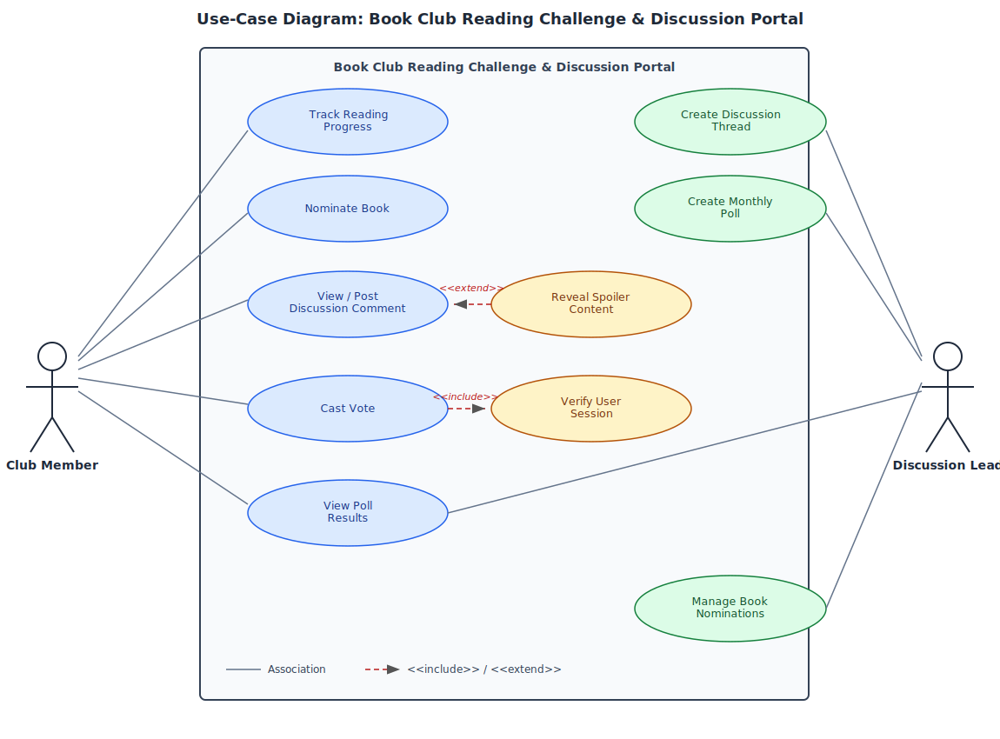

# Book Club Reading Challenge & Discussion Portal

**Course:** PES University – Dept. of CSE
**Lab:** Lab 1 — Requirements Engineering & UML Use-Case Modelling
**Problem Statement:** #55 | Media, Events & Community

---

## 1. Problem Context & Overview

A community reading portal that tracks personal reading page goals, facilitates spoiler-tagged chapter discussion threads, and runs monthly voting polls for next book selection.

**Target Stakeholders / Actors:**
- **Club Member** — tracks reading progress, participates in discussions, nominates books, and votes in monthly polls.
- **Discussion Lead** — creates chapter discussion threads, sets up monthly polls, and manages book nominations.

---

## 2. Repository Structure

```
.
├── README.md                  # This file — project overview & submission index
├── requirements_table.md      # Complete requirements table (5 FR + 2 NFR)
├── usecase_diagram.svg        # UML use-case diagram (vector, source of truth)
├── usecase_diagram.png        # UML use-case diagram (raster, for inline preview)
└── usecase_flow_spec.md       # 1-page use-case flow specification
```

---

## 3. Deliverables Summary

### 3.1 Complete Requirements Table
See [`requirements_table.md`](./requirements_table.md).
Contains exactly 5 Functional Requirements (FR-001–FR-005) and 2 Non-Functional Requirements (NFR-001, NFR-002), each with ID, Type, Description, Priority, Acceptance Criteria, and Rationale.

### 3.2 UML Use-Case Diagram
See [`usecase_diagram.svg`](./usecase_diagram.svg) (or [`usecase_diagram.png`](./usecase_diagram.png) for quick preview).



Models both actors (**Club Member**, **Discussion Lead**) and all primary use cases, including:
- **`<<include>>`**: *Cast Vote* includes *Verify User Session*
- **`<<extend>>`**: *Reveal Spoiler Content* extends *View / Post Discussion Comment*

### 3.3 Use-Case Flow Specification
See [`usecase_flow_spec.md`](./usecase_flow_spec.md).
Details the core use case **"Cast Vote in Monthly Book Poll"**, including Preconditions, Postconditions, Main Success Scenario, and one Alternate Flow (duplicate vote attempt).

---

## 4. How to View
- Markdown files (`.md`) render directly on GitHub.
- `usecase_diagram.svg` renders natively in the GitHub file viewer; `usecase_diagram.png` is included as a fallback/embed for READMEs and slide decks.
