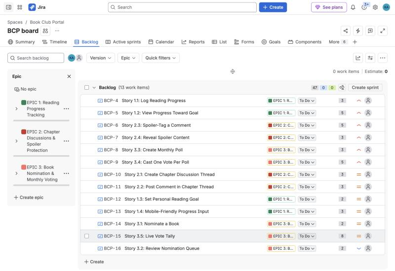
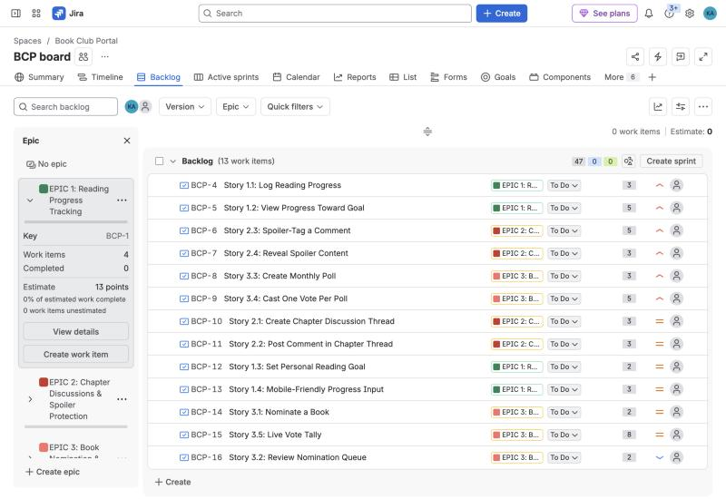
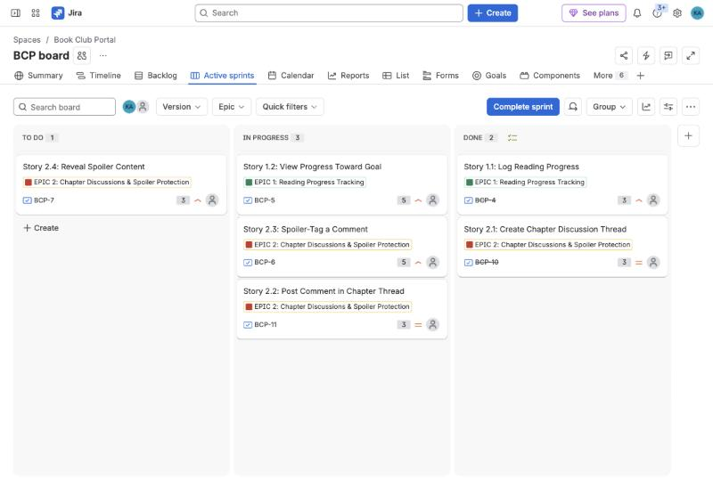
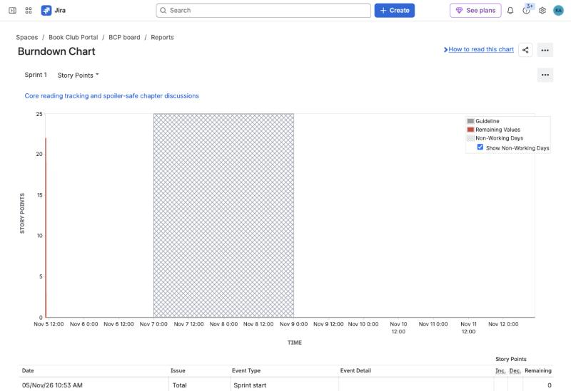
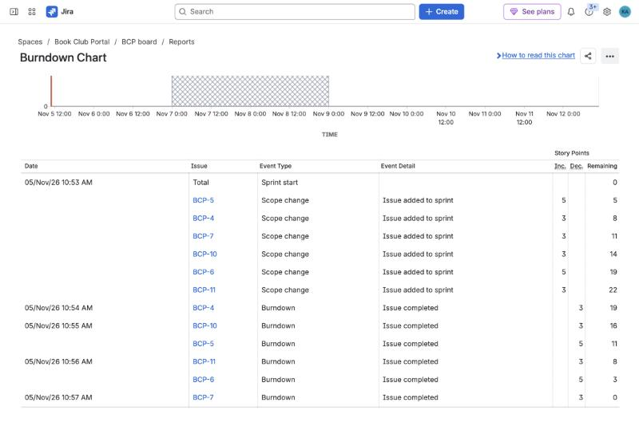
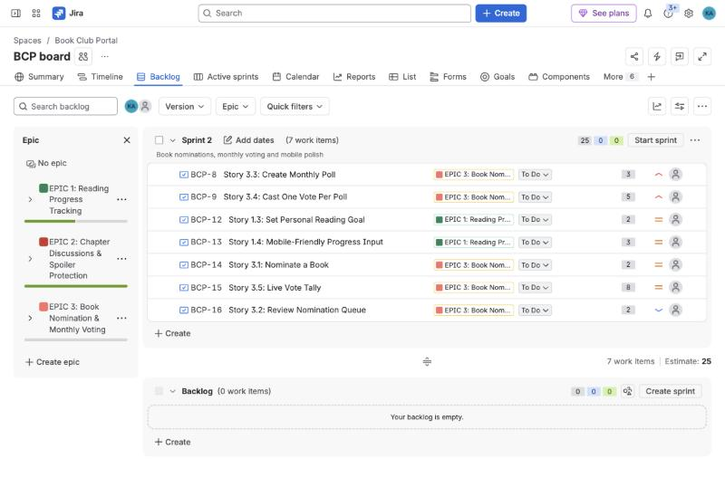
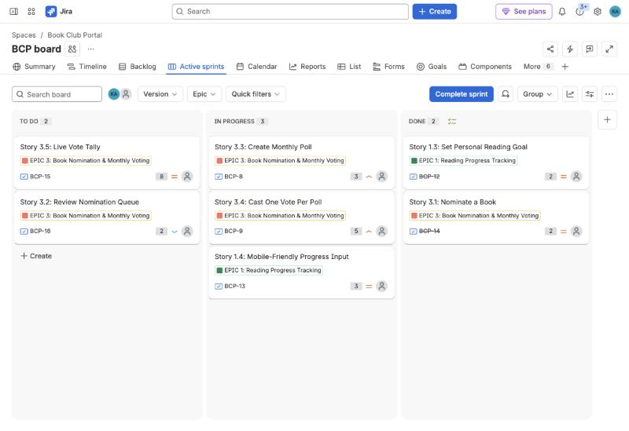
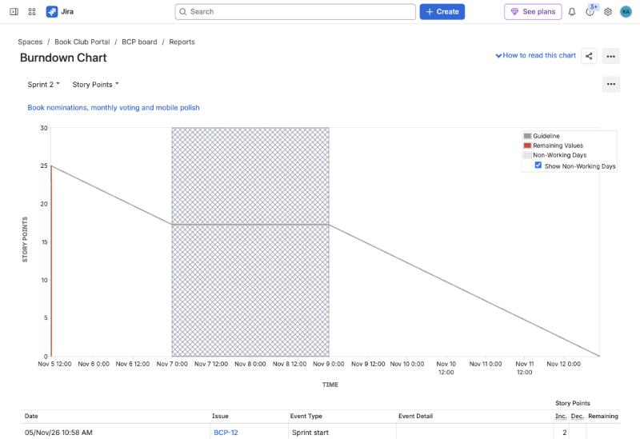
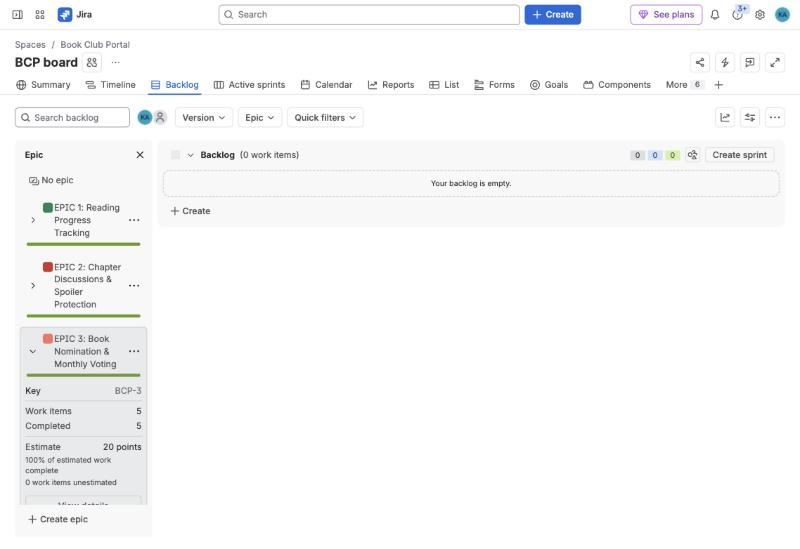

# Lab 2 — Agile Backlog Creation & Sprint Simulation in Jira

**Project:** Book Club Reading Challenge & Discussion Portal (Problem #55, from Lab 1)
**Student:** Keshav Agrawal (PES1UG24CS719)

## Files

| File | Contents |
|------|----------|
| [`backlog.md`](./backlog.md) | 3 Epics and 13 User Stories (As a / I want / So that), priorities, Fibonacci story points, sprint plan |
| [`jira_import.csv`](./jira_import.csv) | The same backlog in a CSV you can import into Jira |
| [`jira_steps.md`](./jira_steps.md) | Step-by-step Jira walkthrough and screenshot checklist |
| [`reflection.md`](./reflection.md) | Answers to the 4 reflection questions |
| [`screenshots/`](./screenshots) | Jira screenshots: backlog, story points, active sprint board, burndown charts |

## Summary

| Epic | Stories | Points |
|------|---------|--------|
| Epic 1: Reading Progress Tracking | 1.1 – 1.4 | 13 |
| Epic 2: Chapter Discussions & Spoiler Protection | 2.1 – 2.4 | 14 |
| Epic 3: Book Nomination & Monthly Voting | 3.1 – 3.5 | 20 |
| **Total** | **13** | **47** |

- **Sprint 1 (1 week, 22 pts):** core reading tracking and spoiler-safe chapter discussions
- **Sprint 2 (1 week, 25 pts):** book nominations, monthly voting and mobile polish

## Screenshots (Jira — project `BCP`, board 2)

### Backlog with Epics and User Stories

### Story point assignments
Epic 1 expanded: 4 work items, 13 points. Each story's points are shown on the right of its row.

### Sprint board — Sprint 1 (Active Sprint view)

### Burndown chart — Sprint 1

### Sprint 2 — planned, active board, burndown

### Both sprints complete — all Epics done

The PDF deliverable (Epics, burndown charts and reflection) is [`Lab2_Jira_Report.pdf`](./Lab2_Jira_Report.pdf).
