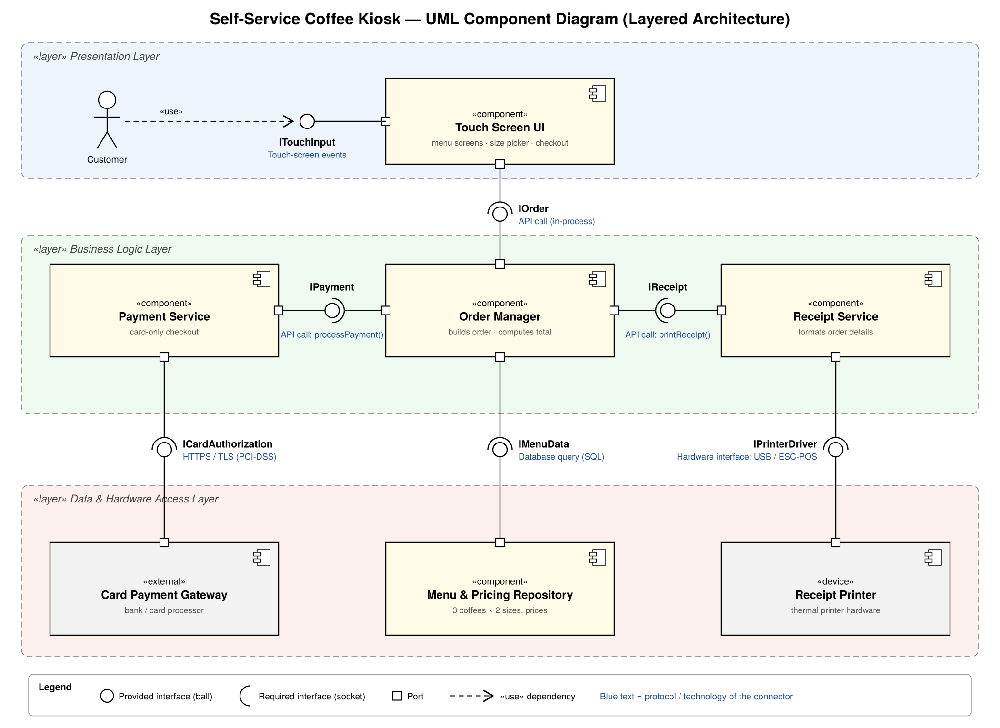

# Lab 3 — Component Modelling & Architectural Pattern Selection

**Scenario:** Self-Service Coffee Kiosk System
**Chosen architecture:** Layered Architecture

## Deliverables

| File | What it is |
|------|------------|
| [`component_diagram.png`](./component_diagram.png) | UML component diagram (PNG export) |
| [`component_diagram.pdf`](./component_diagram.pdf) | Same diagram as PDF |
| [`component_diagram.svg`](./component_diagram.svg) | Vector source of the diagram |
| [`architecture_justification.docx`](./architecture_justification.docx) | One-page written justification (Word) |
| [`architecture_justification.pdf`](./architecture_justification.pdf) | Same justification saved as PDF |

---

## Step 1 — Scenario Review

**Functional requirements**
- Customer selects one of 3 coffee types (Espresso, Americano, Latte)
- Customer selects one of 2 sizes (Small, Large)
- Customer pays by credit card only
- System prints a receipt with the order details

**Non-functional requirements / constraints**
- Must handle touch-screen interaction (usability, fast response)
- Must connect to receipt-printer hardware
- Must store menu data and pricing
- Card payments must be handled securely

**Main challenges**
- *Performance:* the kiosk is in a busy café, so screens and checkout must respond instantly.
- *Usability:* a simple touch flow — choose coffee → choose size → pay → receipt.
- *Security:* card data must be protected and the price must not be changeable from the UI.

## Step 2 — Architectural Style Analysis

| Style | Pros for the kiosk | Cons for the kiosk | Fit |
|-------|-------------------|--------------------|-----|
| **Layered** | Clear UI / logic / data separation; runs fully on one device; easy to build, test and maintain; hardware hidden behind lower layer | Small overhead from passing through layers; whole app deployed as one unit | ✅ **Best fit** |
| **Microservices** | Independent scaling and deployment; fault isolation | Overkill for one kiosk with 3 drinks; network latency between services; much higher operational complexity | ❌ |
| **Client-Server** | Central control of menu/prices across many kiosks; simple data consistency | Kiosk stops working if the server or network is down (single point of failure); every tap needs a network round-trip | ⚠️ Possible, but less reliable |

## Step 3 — Architecture Selection & Component Identification

**Selected:** Layered Architecture (Presentation → Business Logic → Data & Hardware Access).

| # | Component | Layer | Responsibility |
|---|-----------|-------|----------------|
| 1 | Order Manager *(given)* | Business | Builds the order (type + size), computes total, coordinates payment and receipt |
| 2 | Payment Service *(given)* | Business | Processes the credit-card payment through the external gateway |
| 3 | Touch Screen UI | Presentation | Shows menu and size options, takes touch input, shows checkout status |
| 4 | Menu & Pricing Repository | Data | Stores the 3 coffee types, 2 sizes and their prices |
| 5 | Receipt Service | Business | Formats order details and sends them to the printer |

External / hardware elements: **Card Payment Gateway** («external») and **Receipt Printer** («device»).

## Step 4 — Interfaces in the Diagram

| Interface | Provided by (ball) | Required by (socket) | Protocol / technology |
|-----------|-------------------|----------------------|-----------------------|
| `ITouchInput` | Touch Screen UI | Customer («use») | Touch-screen events |
| `IOrder` | Order Manager | Touch Screen UI | API call (in-process) |
| `IPayment` | Payment Service | Order Manager | API call: `processPayment()` |
| `IReceipt` | Receipt Service | Order Manager | API call: `printReceipt()` |
| `IMenuData` | Menu & Pricing Repository | Order Manager | Database query (SQL) |
| `ICardAuthorization` | Card Payment Gateway | Payment Service | HTTPS / TLS (PCI-DSS) |
| `IPrinterDriver` | Receipt Printer | Receipt Service | Hardware interface: USB / ESC-POS |

## Step 5 — Written Justification

See [`architecture_justification.pdf`](./architecture_justification.pdf): architectural choice, two scenario-specific reasons, one security advantage and one performance benefit.
