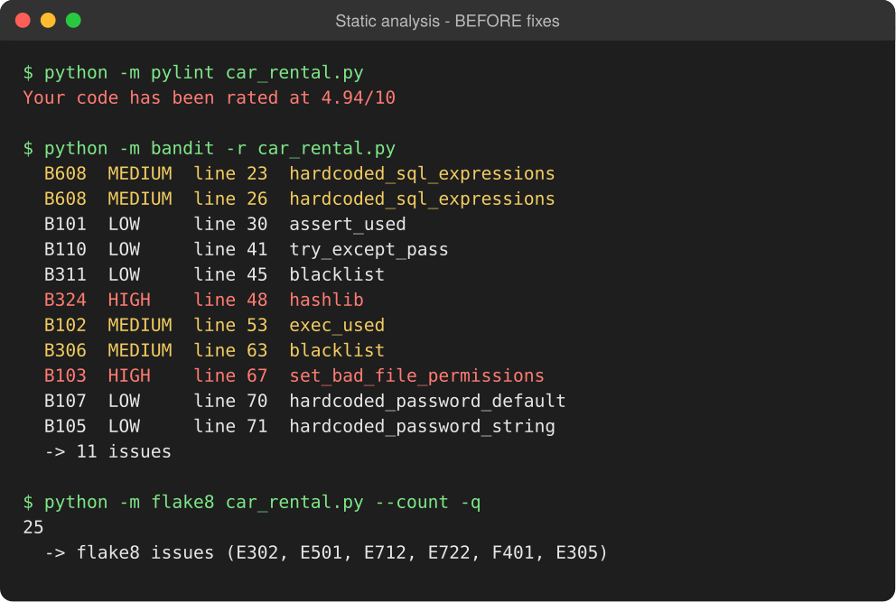
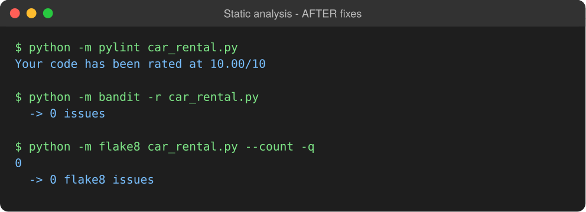
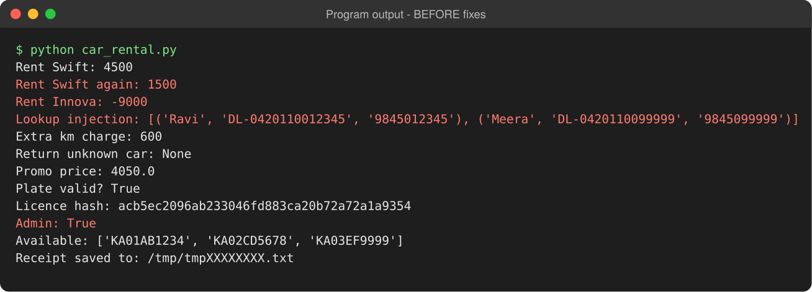
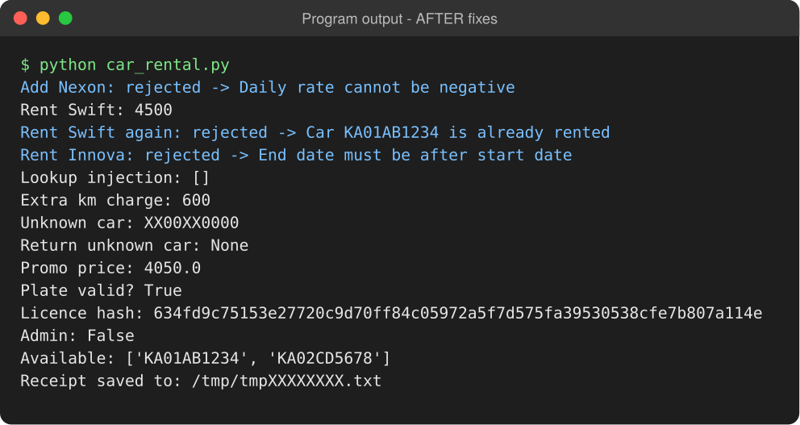

# Lab 5 — Static Code Analysis (Car Rental System)

**Student:** Keshav Agrawal (PES1UG24CS719)
**Assigned repo:** [SETAPESU26/L5_56_car-rental](https://github.com/SETAPESU26/L5_56_car-rental)
**Tools:** Pylint 4.1.3 · Bandit 1.9.4 · Flake8 7.5.0 · Python 3.13

## Results

| Tool | Before | After |
|------|--------|-------|
| Pylint | 4.94 / 10 | **10.00 / 10** |
| Bandit | 11 issues (2 High, 4 Medium, 5 Low) | **0** |
| Flake8 | 25 issues | **0** |

## Files

| File | Contents |
|------|----------|
| [`car_rental.py`](./car_rental.py) | Cleaned and fixed program |
| [`issues.md`](./issues.md) | Issue table — issue, type, lines, description, fix approach |
| [`reflection.md`](./reflection.md) | Answers to the reflection questions |
| [`reports_before/`](./reports_before) | `pylint_report.txt`, `bandit_report.txt`, `flake8_report.txt` on the original file |
| [`reports_after/`](./reports_after) | The same three reports on the fixed file |
| [`screenshots/`](./screenshots) | Terminal screenshots before and after |

## Commits (one per tool)

1. `Lab 5: add assigned car_rental.py and baseline tool reports`
2. `Fix Bandit security issues in car_rental.py`
3. `Fix Pylint issues in car_rental.py (4.94 -> 10.00/10)`
4. `Fix Flake8 (PEP 8) issues in car_rental.py`
5. `Fix logic bugs found by running car_rental.py`
6. `Add after-fix reports, issue table, reflection and screenshots`

## Screenshots

### Static analysis — before


### Static analysis — after


### Program output — before
Wrong behaviour highlighted in red: a car rented twice, a cost of −9000, the SQL-injection lookup returning every customer, and admin login with the default password.



### Program output — after


## How to reproduce

```bash
python3 -m venv venv && source venv/bin/activate
pip install pylint bandit flake8
python car_rental.py
python -m pylint car_rental.py > pylint_report.txt
python -m bandit -r car_rental.py > bandit_report.txt
python -m flake8 car_rental.py > flake8_report.txt
```
