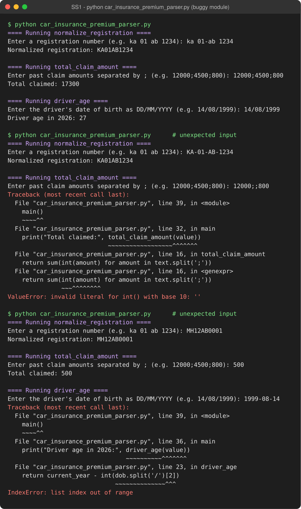
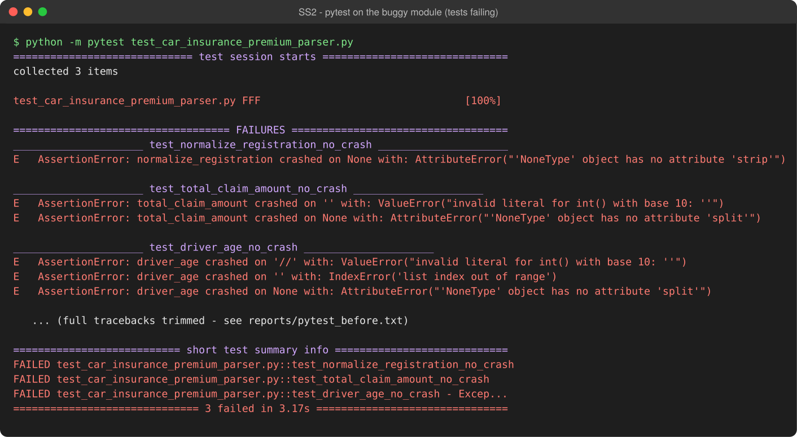
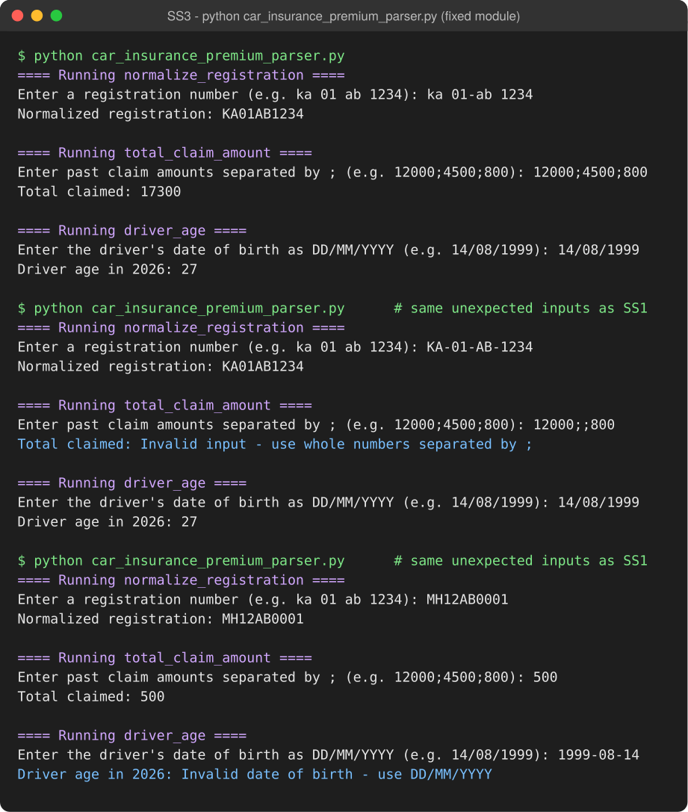
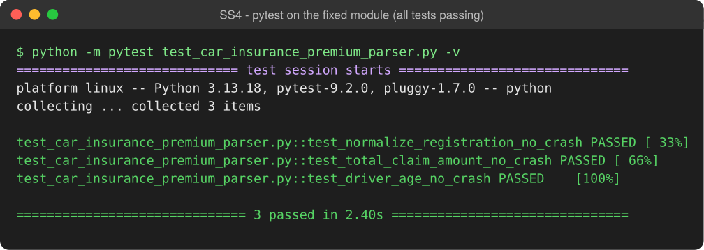

# Lab 7 — Fuzzing for Input Validation Bugs (Car Insurance Premium)

**Student:** Keshav Agrawal (PES1UG24CS719)
**Assigned repo:** [SETAPESU26/L6_L7_55_car_insurance_premium](https://github.com/SETAPESU26/L6_L7_55_car_insurance_premium), `LAB7` folder
**Tools:** Python 3.13 · Hypothesis · pytest

## Deliverables

| File | Contents |
|------|----------|
| [`car_insurance_premium_parser.py`](./car_insurance_premium_parser.py) | Fixed module: all three functions handle any input without crashing |
| [`test_car_insurance_premium_parser.py`](./test_car_insurance_premium_parser.py) | Completed Hypothesis tests, one for each function |
| [`PES1UG24CS719_KESHAV_AGRAWAL_LAB7.pdf`](./PES1UG24CS719_KESHAV_AGRAWAL_LAB7.pdf) | Screenshots SS1–SS4 and the reflection answers |
| [`reflection.md`](./reflection.md) | Reflection answers |
| [`reports/`](./reports) | Full pytest output before and after the fix |

## Bugs found by fuzzing

| Function | Failing input | Crash | Fix |
|----------|---------------|-------|-----|
| `normalize_registration` | `None` | AttributeError | Return `''` for non-string input |
| `total_claim_amount` | `''`, `'12000;;800'`, `None` | ValueError / AttributeError | Validate each amount as ASCII digits; return `None` if invalid |
| `driver_age` | `''`, `'1999-08-14'`, `'//'`, `None` | IndexError / ValueError / AttributeError | Validate a real `DD/MM/YYYY` date, no future dates, age 0–120; else `None` |

## Screenshots

### SS1 — buggy module run


### SS2 — tests failing on the buggy module


### SS3 — fixed module run


### SS4 — all tests passing on the fixed module


## Run it

```bash
pip install hypothesis pytest
python car_insurance_premium_parser.py
python -m pytest test_car_insurance_premium_parser.py -v
```
